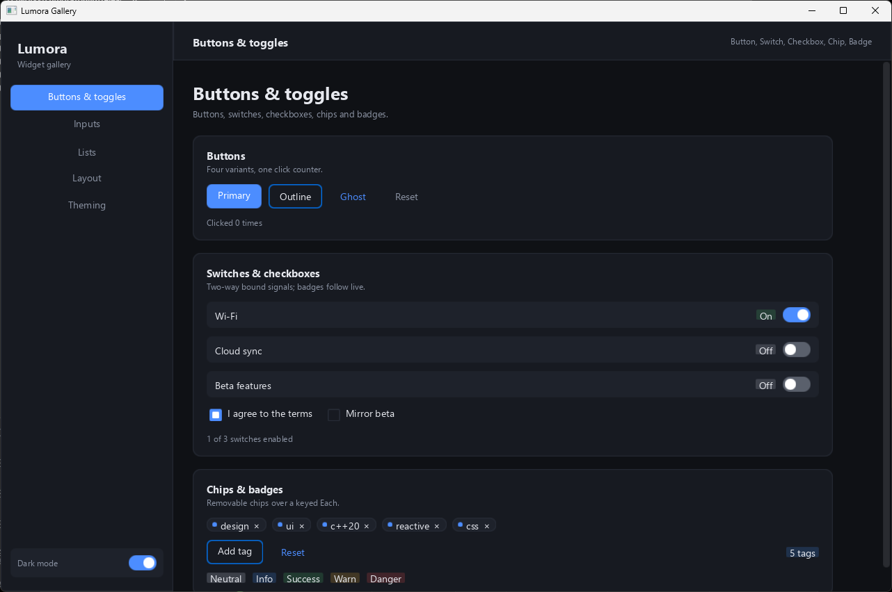
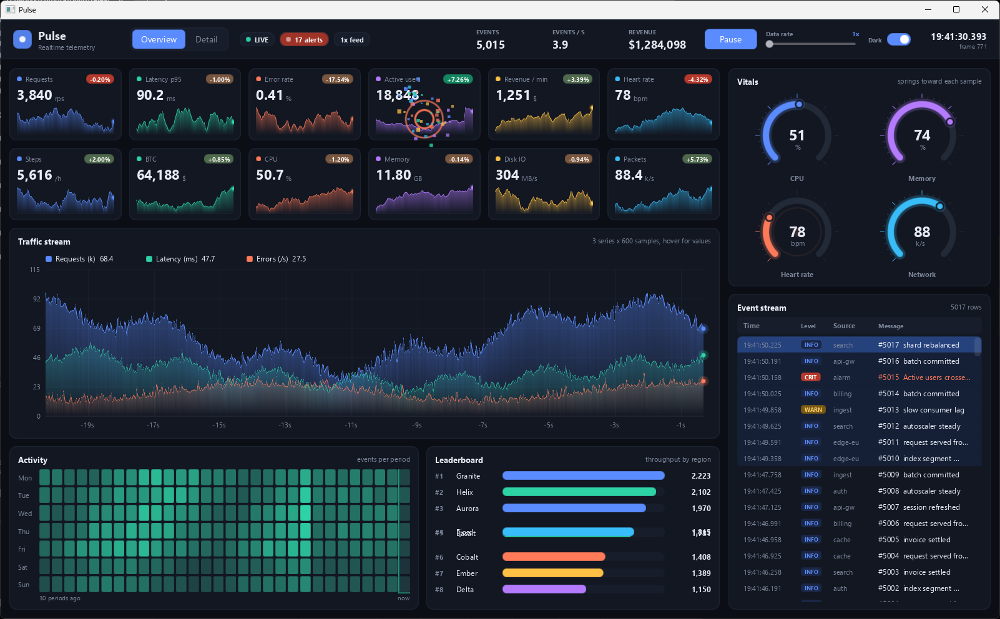
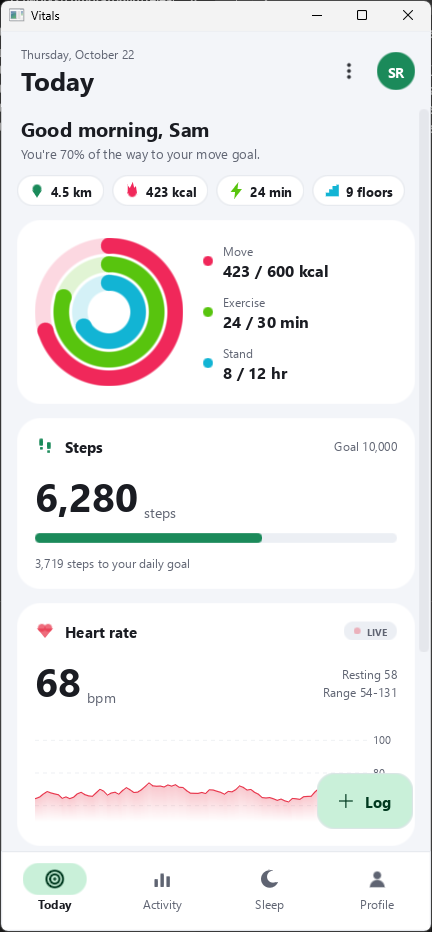

# Lumora

A reactive, GPU-rendered C++20 GUI library. Components and signals on top, a CSS subset for styling, flexbox layout, and a Vulkan 1.1 renderer underneath.

- **Reactive core**: `Signal`, `Computed`, `Effect`, `Each`, and `Show` with fine-grained dependency tracking.
- **CSS styling**: selectors, cascade, variables, media queries, transitions, keyframes, and transforms.
- **Flexbox layout**: flexbox containers, items, grid tracks, alignment, and gaps.
- **Widgets**: buttons, switches, checkboxes, inputs, text editor, lists, virtual lists, grids, docking, menus, node graph editor, and SVG.
- **Full text support**: text shaping, bidirectional text reordering, and line breaking.
- **GPU rendering**: batched rendering pipeline targeting Vulkan 1.1 with embedded SPIR-V shaders.

## Build

### Requirements

- CMake 3.28+
- Ninja
- C++20 compiler (tested with MSVC 2022)
- Vulkan SDK (includes `dxc` for compiling HLSL shaders to SPIR-V)

### Building with Presets

```sh
cmake --preset debug
cmake --build --preset debug
```

For release builds:

```sh
cmake --preset release
cmake --build --preset release
```

On Windows, `scripts\build.cmd` and `scripts\release.cmd` set up the MSVC environment first before building. Build output is placed in `build/<preset>`.

### Linux (X11 and Wayland)

The desktop Linux platform layer ships both window backends and picks one at runtime: Wayland when `WAYLAND_DISPLAY` answers, otherwise X11. Set `LUMORA_WINDOW_BACKEND=x11` or `wayland` to force one. Build dependencies (Debian/Ubuntu names): `libx11-dev libx11-xcb-dev libxcb1-dev libxkbcommon-dev libxkbcommon-x11-dev libxi-dev libxcursor-dev libxfixes-dev libxrandr-dev libwayland-dev libvulkan-dev`, plus `libdecor-0-dev` for client-side window decorations on GNOME. `zenity` (or `kdialog`) provides the file dialogs and boot progress window. Without the X11/Wayland packages the build stays headless.

### Headless Linux Presets

`CMakePresets.json` defines headless configurations where GPU rendering and samples are disabled (`LUMORA_BUILD_GPU=OFF`, `LUMORA_BUILD_SAMPLES=OFF`):

- `linux-profile`: RelWithDebInfo build with frame pointers (`-fno-omit-frame-pointer`) for profiling.
- `linux-asan`: RelWithDebInfo build configured with AddressSanitizer and UndefinedBehaviorSanitizer (`-fsanitize=address,undefined`).

## Benchmarks

| Scene | What changes each frame | Frame time (ms) | Heap per node |
|---|---|---|---|
| static-idle | nothing | 0.018 | 2.6 KB |
| one-leaf-write | one text leaf in a 2000-node tree | 0.75 | 2.7 KB |
| repaint-one-leaf | one fill colour | 0.15 | 2.7 KB |
| hover-transitions | pointer moves across CSS `:hover` transitions | 1.15 | 3.9 KB |
| virtual-list | scrolling a 20000-row list | 0.05 | 1.6 KB |
| text-panel | nothing (200 rows of text labels, real font) | 0.006 | 2.9 KB |

## Samples

Executable samples under `Samples/`:

- **Gallery**: Component showcase demonstrating buttons, toggles, text inputs, lists (scrolling and virtualized), layout splitters, and theme switching.
- **NodeStudio**: Interactive visual node graph editor with draggable nodes, pin connections, inspector panel, palette, and canvas navigation.
- **Pulse**: Real-time observability dashboard displaying streaming traffic charts, animated gauges, heatmaps, live metric grids, and event feeds.
- **Vitals**: Mobile health and wellness interface featuring tab navigation (Today, Activity, Sleep, Profile), bottom navigation, cards, bottom sheets, FAB, and accent color themes.







## ThirdParty

| Library | Version | Role | Source |
|---|---|---|---|
| [FreeType](https://github.com/freetype/freetype) | VER-2-13-3 | Glyph rasterisation for text rendering | Fetched |
| [HarfBuzz](https://github.com/harfbuzz/harfbuzz) | 10.1.0 | OpenType text shaping | Fetched |
| [SheenBidi](https://github.com/Tehreer/SheenBidi) | v3.0.0 | Unicode Bidirectional Algorithm implementation | Fetched |
| [libunibreak](https://github.com/adah1972/libunibreak) | libunibreak_6_1 | Unicode line breaking algorithm (UAX #14) | Fetched |
| [Masharif](https://github.com/alielmorsy/Masharif) | v1.2 | Flexbox layout solver | Fetched |
| [libtess2](https://github.com/memononen/libtess2) | v1.0.2 | Polygon tessellation for SVG fills | Fetched |
| [spdlog](https://github.com/gabime/spdlog) | v1.15.1 | Logging library | Fetched |
| [GoogleTest](https://github.com/google/googletest) | v1.15.2 | Unit test framework (test targets only) | Fetched |
| [stb](https://github.com/nothings/stb) | Vendored | Image loading (`stb_image.h`) for renderer texture providers | Vendored |
| [Vulkan Memory Allocator](https://github.com/GPUOpen-LibrariesAndSDKs/VulkanMemoryAllocator) | Vendored | GPU memory allocation management | Vendored |
| [Vulkan SDK](https://www.lunarg.com/vulkan-sdk/) | 1.1+ | System dependency for Vulkan loader, headers, and `dxc` shader compiler | System |

Fetched libraries are cloned into `ThirdParty/` at configure time by `cmake/FetchThirdParty.cmake`.

## Documentation

- [CSS Reference](docs/CSS.md): Selectors, cascade, properties, custom properties, animations, and transitions.
- [Text Rendering Notes](docs/TextRendering.md): Font discovery, text shaping pipeline, glyph cache, and atlas packing.
- [Rectangle Rendering Notes](docs/RectRendering.md): Batched primitive rendering, borders, rounded corners, and shader pipeline.
